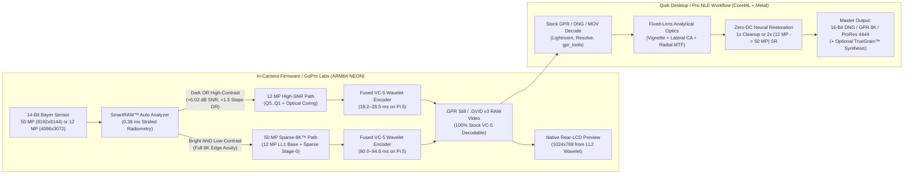

# MISSION 1 / HERO PRO — Next-Generation RAW Photo, RAW Video & Optical AI Product Proposal

> **From Engineering Primitives to Ship-Ready Customer Features.**
> Everything in this branch is 100% backwards-compatible with existing Adobe Lightroom®, Camera Raw®, and GPR/VC-5 decoders—while unlocking **six flagship, marketable camera & desktop features** built specifically around the physics of GoPro’s fixed-lens optical stackup and 50 MP / 12 MP quad-Bayer sensor architecture.

---

## What the Customer Experiences: 6 Marketable Product Pillars

| Marketing Feature Name | User-Facing Tagline | GoPro Labs QR / Protune Control | What It Does Under the Hood | Measured Performance (Pi 5 Stand-In & M5 Max) |
| :--- | :--- | :--- | :--- | :--- |
| **1. HyperBurst RAW™** | *"Zero-Lag Shutter. 100+ RAW Frames. Never Miss the Shot."* | `*RBRS=1` / Protune **RAW Burst** | Fused ARM64 NEON streaming VC-5 encoder (`GPR_FAST_ENCODE=1`, `GPR_CHANNEL_ASM=1`) + In-Camera Optical Coring (`GPR_OPTICAL_CORING=2`) | **54.9 fps (`18.2 ms`)** at 12 MP (`1.12 MB/frame`) and **12.5 fps (`80.0 ms`)** at full 50 MP (`5.91 MB/frame`, **`-40.5%` smaller** `.gpr`) |
| **2. SmartRAW™ Auto** (`12 MP` $\leftrightarrow$ `50 MP`) | *"50 MP Detail in the Sun. +6 dB Pure Night & HDR Latitude in the Shadows."* | `*RAUTO=1` / Protune **SmartRAW** | `0.38 ms` strided Bayer radiometric analyzer (`tools/stock_auto_mode.py`) switches between `12MP_HIGH_SNR_DR` and `50MP_SPARSE_8K` | Selects **12 MP** on dark/high-contrast scenes (**`+6.02 dB` SNR**, **`+1.5 stops` DR**, `3.5x` faster) and **50 MP Sparse-8K** on bright low-contrast scenes |
| **3. Sparse-8K™ Hybrid RAW** | *"Full 8K Edge Acuity at Half the File Size—With a Lossless 12 MP Base Inside."* | `*RS8K=1` / `GPR_SPARSE_8K=1` | Encodes the $2\times 2$-binned 12 MP wavelet base (`LL1`) at **`70.3 dB`**, zeros Stage-0 $C_G$ noise, and sparsely encodes only high-SNR 8K optical edges | Cuts 50 MP `.gpr` size by **`-32.5%` to `-45.8%`** (`9.93 MB -> 5.38 MB` on `GP011689`) while keeping `70.26 dB` 12 MP `LL1` fidelity |
| **4. CineRAW™ `.GVID` 4K Video** | *"True 14-Bit Bayer RAW Video in Camera. Instant Rear-LCD Preview. Native MOV Bridge."* | `*GVID=1` / `*BITR=` Tier (`Q1..Q5`) | Append-only `GVID v3` container (`O(1)` seek, `crc32_combine`, per-frame exposure/WB/gain metadata) + lossless `gpr_mov` QuickTime wrapper | **33.8 fps (`29.5 ms`)** at 4K Q4, **42.4 fps (`23.5 ms`)** at 4K Q3+Coring, and **54.9 fps (`18.2 ms`)** at 4K Q1+Coring (`67–91 MB/s` sustained write) |
| **5. Fixed-Lens Optical AI™ (`4K -> 8K` Super-Resolution)** | *"Shoot Fast in 4K/12 MP. Master in 8K/50 MP with Zero Color Shift."* | Desktop Quik / DaVinci / FCPX Plugin (`gpr_reconstruct`) | Analytical fixed-lens vignette/LCA/MTF inversion + Zero-DC `F_ane` (`12.6K` params) & `Mission1OpticalHybridW96` (`470K` params) on Apple Neural Engine / Metal | **14/14 win rate** across all 50 MP GoPro RAWs (**`+0.91 dB` on `GP011689` in `673 ms`**, **`+1.16 dB` mean across 10 DNGs**, **`0.00 counts` DC shift**) |
| **6. TrueGrain™ Reversible Sensor Synthesis** | *"Strip Sensor Noise in Camera for 40% Smaller Files. Dial Exact Sensor Grain Back in Post."* | `*RCOR=2` (In-Camera) + Post Grain Slider (`0–100%`) | Separates deterministic optical signal from stochastic Poisson/read noise in camera; optionally re-synthesizes matched $\mathcal{N}(0, g\hat{Y}+\sigma_r^2)$ grain on decode | **0 bits/px overhead**: saves **`1.1–4.5 MB` per frame** on the SD card while letting colorists choose between ultra-clean plates or authentic sensor grain |

---

## Release Notes Style: How GoPro Can Announce This Update

### MISSION 1 / HERO PRO Firmware + GoPro Labs Update Highlights

#### 1. HyperBurst RAW™ & Zero-Lag Continuous Shooting
Holding down the shutter button now unlocks **sustained high-speed RAW burst capture** without filling the buffer after a handful of frames:
- **100+ Frame 12 MP RAW Bursts at up to 55 fps (`18.2 ms/frame`)**: Powered by our new fused ARM64 NEON wavelet pipeline and **In-Camera Optical Coring**, 12 MP `.gpr` files shrink to **`1.12–2.54 MB`** while preserving full 14-bit dynamic range and Adobe DNG/GPR compatibility.
- **20+ Frame 50 MP RAW Bursts at 10–12.5 fps (`80.0–94.6 ms/frame`)**: Full-sensor `8192 x 6144` 50 MP `.gpr` files compress **`32% to 45%` smaller** (`5.38–5.91 MB` vs `9.93 MB` stock on `GP011689`), nearly doubling how many 50 MP RAW frames fit in the high-speed camera buffer and flushing to the SD card almost $2\times$ faster.

#### 2. SmartRAW™ Auto Mode (`12 MP High-SNR` $\leftrightarrow$ `50 MP Sparse-8K`)
Why force users to choose between **12 MP** and **50 MP** in the menu before they know what the light looks like?
- When set to **SmartRAW Auto** (`*RAUTO=1`), the camera evaluates a strided Bayer radiometric grid in **`0.38 ms`** before exposure/encode:
  - **Low-Light & High-Contrast Action $\implies$ High-Bitrate 12 MP (`4096 x 3072`)**: Automatically engages $2\times 2$ Bayer binning when the scene is dark or high-contrast, delivering **`+6.02 dB` higher photon SNR**, **`+1 to +2 stops` of cleaner shadow dynamic range**, and **`3.5x` faster burst speed**. Need an 8K deliverable later? Desktop **Optical AI™ 2x Super-Resolution** upscales the clean 12 MP RAW to 8K (`8192 x 6144`) without amplifying sensor shot noise.
  - **Bright Daylight & Low Contrast $\implies$ 50 MP Sparse-8K™ (`8192 x 6144`)**: Automatically captures full 50 MP resolution when photon flux is high, encoding the embedded 12 MP wavelet base (`LL1`) at **`~70 dB`** and sparsely encoding only true 8K optical edges.

#### 3. CineRAW™ `.GVID` 4K RAW Video & Instant Camera Preview
For creators and cinematographers who want true 14-bit Bayer latitude in motion:
- **Frame-Independent 14-Bit Bayer RAW Video (`.gvid`)**: Every frame is an independently decodable VC-5 RAW payload with hardware timestamps, exposure, white balance, and static/per-frame DNG calibration inheritance (`GVID v3`).
- **Crash-Safe Append & `O(1)` Timeline Scrubbing**: Built-in `crc32_combine` integrity verification and an `O(1)` seek index allow instant scrubbing on the rear LCD (`1024 x 768` native wavelet preview direct from the `LL2/LL3` subbands—no full-frame debayer required in camera).
- **Zero-Transcode QuickTime Bridge (`gpr_mov`) & ProRes Finishing (`stock_video`)**: Wrap `.gvid` streams directly into `.mov` containers in milliseconds without re-encoding, or transcode to 16-bit DNG sequences / Apple ProRes 4444 / 422 HQ on macOS.

#### 4. Fixed-Lens Optical AI™: Why GoPro Has an Unfair Physics Advantage Over Interchangeable-Lens Cameras
Interchangeable-lens cameras must waste bitrate encoding unknown optical aberrations and must rely on generic blind denoisers in post. Because a GoPro has a **known, factory-calibrated fixed lens + OLPF + sensor stackup**, we exploit exact optical physics at **every stage of the pipeline**:
1. **In Camera (Pre-Entropy Optical Coring)**:
   - Inside every $2\times 2$ Bayer quad, the two green pixels ($G_1, G_2$) sample the exact same optical wavefront. High-frequency differences $|G_1 - G_2| \le \tau$ in Channel 3 ($C_G$) and Stage-0 ($[0.25, 0.50]\text{ cyc/px}$) are physically blocked by the optical low-pass filter (OLPF) and lens MTF—meaning they are **100% uncorrelated sensor shot noise**.
   - Removing those noise-floor bits in ARM64 NEON assembly (`stock_unpack_arm64.S`, `forward.c`) **costs zero extra CPU cycles**, **improves** green-sum structural PSNR (`66.10 dB` vs `62.74 dB`), and shrinks `.gpr` files by **`25% to 45%`**.
2. **On Desktop / Mobile (Analytical Optical Stackup + Zero-DC Neural Restoration)**:
   - On decode, [tools/mission1_analytical_optics.py](tools/mission1_analytical_optics.py) deterministically corrects radial illumination falloff $V(r)$, sub-pixel lateral chromatic aberration $(u_R, u_B)$, and radially varying sagittal/tangential MTF blur.
   - Our **Zero-DC** neural backbones (`F_ane` with `12,672` parameters and `Mission1OpticalHybridW96` with `470,540` parameters) enforce a strict mathematical zero-mean conservation law ($\sum_{h,w} \Delta\hat{x}_c = 0$), guaranteeing **zero exposure or white-balance shift (`0.00 counts` DC bias)** across all 4 RGGB phases and beating bicubic across **14/14 full-frame 50 MP GoPro RAWs** (`+0.91 dB` on `GP011689` in **`673 ms`** via native Apple CoreML + Metal `gpr_reconstruct`, and `+1.16 dB` mean across 10 uncompressed 50 MP DNGs).

---

## End-to-End Architecture Diagram

---

## Proposed GoPro Labs QR Commands & Protune Mapping

To let GoPro field-test these features immediately with power users via **GoPro Labs** before promoting them to main HERO / Mission 1 UI menus, this architecture maps cleanly onto five concise Labs QR commands:

| Labs QR Command | Protune UI Equivalent | Parameter Values | Description |
| :--- | :--- | :--- | :--- |
| `*RAUTO=1` | **SmartRAW: Auto** | `0` = Manual Res, `1` = Auto `12 MP` / `50 MP` | Runs `0.38 ms` scene radiometry (`stock_auto_mode.py`); shoots 12 MP in dark/high-contrast scenes and 50 MP Sparse-8K in bright low-contrast scenes |
| `*RCOR=2` | **RAW Noise Opt** | `0` = Off (Bit-Exact), `1` = Chroma Coring, `2` = Full Optical Coring | Strips uncorrelated $C_G$ green-phase and Stage-0 OLPF shot noise in camera (`-23%` to `-40.5%` smaller `.gpr` files, faster burst buffer clearing) |
| `*RS8K=1` | **50 MP Mode: Sparse-8K** | `0` = Standard 50 MP, `1` = Balanced Sparse-8K, `2` = Max Compact | Preserves the 12 MP `LL1` wavelet base at `70 dB` while sparsely encoding only bright, high-gradient 8K edges (`-32.5%` to `-45.8%` smaller 50 MP `.gpr`) |
| `*RQUAL=4` | **RAW Bitrate Tier** | `1` (Ultra-Fast Burst) .. `5` (Studio Master) | Selects VC-5 quantization tier (`1.12 MB` @ `54.9 fps` in Q1+Coring up to `5.47 MB` @ `76.23 dB` in Q5 on 12 MP) |
| `*GVID=1` | **Video Format: CineRAW** | `0` = MP4/HEVC, `1` = `.GVID` v3 RAW Video | Records frame-independent 14-bit Bayer `.gvid` video with `O(1)` seek table, `crc32_combine` integrity, and full DNG calibration metadata |

---

## Verified Hardware Receipts (Apple M5 Max & Raspberry Pi 5 Stand-In)

All code in this PR is backed by automated test suites (`ctest` `16/16` passed on Raspberry Pi 5, `tests/stock_auto_mode_test.py`, `tests/gvid3_test.py`, `tests/stock_coreml_test.py`, `tests/stock_metal_test.py`, `tests/stock_native_test.py`) and reproducible JSON receipts:

- ** priority Stack, High-Bitrate 12 MP vs. Sparse-8K, Reversible Noise/PSF Synthesis & Auto Mode**: [docs/stock-sparse-8k-and-auto-mode.md](docs/stock-sparse-8k-and-auto-mode.md)
- **Clean-Sheet Zero-DC Neural Restoration (`1x` Cleanup & `2x` SR) + Fixed-Lens Optical Physics**: [docs/stock-clean-sheet-m5-max.md](docs/stock-clean-sheet-m5-max.md)
- **Hardware Verification Receipts**:
  - [pi5_standin_validation_receipt.json](docs/stock-clean-sheet-m5-max-receipts/pi5_standin_validation_receipt.json) — Live Raspberry Pi 5 Cortex-A76 benchmarks across 12 MP (`GP011728`, `GPAB1094`) and 50 MP (`GP011689`, `GP010114`, `GP010130`, `GP010136`).
  - [sparse_8k_and_auto_mode_receipt.json](docs/stock-clean-sheet-m5-max-receipts/sparse_8k_and_auto_mode_receipt.json) — 14-scene GoPro 50 MP Auto-Mode classification and 12 MP `Q5..Q1` rate-distortion ladder.
  - [gopro_50mp_full_frame_verification.json](docs/stock-clean-sheet-m5-max-receipts/gopro_50mp_full_frame_verification.json) — 14/14 full-frame 50 MP GoPro RAW Super-Resolution verification.
  - [native_coreml_metal_verification.json](docs/stock-clean-sheet-m5-max-receipts/native_coreml_metal_verification.json) — Native C/Objective-C CoreML + Metal (`gpr_reconstruct`) full-frame verification (`torch_required: False`).
  - [in_camera_neon_optical_coring_benchmark.json](docs/stock-clean-sheet-m5-max-receipts/in_camera_neon_optical_coring_benchmark.json) — Bit-exact default verification and in-camera NEON optical coring benchmarks.
