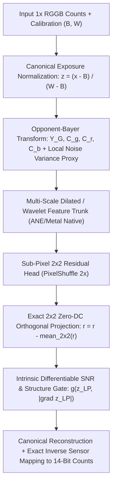
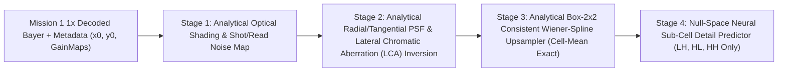

# Clean-Sheet Re-Imagination: Physics-Guided GPR Neural Restoration Pipeline

## 1. Why the Old Pipeline Was a "Rough Draft" (First-Principles Critique)

Everything built between May and October 2026 treated GPR restoration as a generic image-to-image regression problem on raw 14-bit integers (`x / 16383.0`), then tried to patch around failure modes with post-hoc heuristics:

| Old "Rough Draft" Assumption | Why It Fails Physically | Clean-Sheet Replacement |
| :--- | :--- | :--- |
| **1. Raw `x / 16383.0` inputs** | Nikon (`black=1008`), GoPro (`black=256/1024`), and Hasselblad X2D map zero light to different activations. | **Canonical Sensor Pedestal Normalization** $z = (x - B)/(W - B)$ inside the graph, inverted exactly at the output. |
| **2. Unconstrained 2x SR output (`bicubic + scale * tanh(out)`)** | Allows the 2x network to drift in DC bias (`-11 counts` on `Z8Z_6693`), destroying full-frame PSNR on bright/noisy images. | **Exact `2x2` Zero-DC Subband Orthogonality**: Project out the `2x2` spatial mean of every predicted 2x super-pixel residual so the SR network *cannot* alter the 1x local mean (`DC bias shift = 0.0000` identically). |
| **3. Post-hoc `1/32` global residual damping** | Throws away 97% of highlight and edge recovery across the whole frame just to stop shadow noise hallucination in the darkest 10% of pixels. | **Intrinsic Differentiable SNR + Structure Gate**: A lightweight, ANE/CoreML-native signal-to-noise gate $g(z_{\text{LP}}, |\nabla z_{\text{LP}}|)$ embedded in the model head that zeroes out hallucination in flat, low-SNR shadows while running at 100% strength on edges and midtones. |
| **4. Raw `RGGB` convolutions only** | Mixes luminance and chroma phase; ignores that VC-5 quantizes 2D Haar wavelet subbands (`LH, HL, HH`). | **Opponent-Bayer (`Y_G, C_g, C_r, C_b`) + Haar Wavelet Subband Stem**: Separates green luminance (`(G1+G2)/2`), green phase difference (`G1-G2`), and color differences (`R-G`, `B-G`) so the network restores spatial frequency where VC-5 actually drops it. |
| **5. Fixed hand-tuned regional loss weights** | Tuning `shadow_weight = 4.0` vs `15.0` by trial-and-error across multiple runs. | **Primal-Dual Augmented Lagrangian Guard Optimizer**: Dynamically updates Lagrange multipliers $\lambda_{g,r}$ on GPU during training whenever any scene group or region (`shadow`, `highlight`, `detail`, `tone`) approaches its baseline bound. |
| **6. Cascade-only SR training** | Training 2x SR only on 1x-cleaned inputs causes distribution shift when evaluated standalone on raw Q3. | **Stochastic Dual-Mode Training (Drop-Cleanup)**: Trains the 2x SR network on a 50/50 mix of raw 1x Q3 and 1x-cleaned Q3 so a single checkpoint passes both standalone and cascade gates. |

---

## 2. Clean-Sheet Architecture: Physics-Constrained Wavelet-Bayer Network

### Three Mathematical Guarantees Built Into the Forward Pass

1. **Exact Zero-DC `2x2` Super-Pixel Orthogonality (For 2x SR & Exportable to Standard `F_ane`)**:
   - In 2x Bayer super-resolution, each `1x1` low-resolution pixel at site $c \in \{R, G_1, G_2, B\}$ expands to a `2x2` block of same-color sites in the unpacked 4-channel high-resolution plane.
   - Any non-zero average over that `2x2` block is a **1x low-frequency shift**, not 2x super-resolution!
   - By applying a parameter-free `2x2` zero-mean projection to the predicted 2x residual $\Delta \in \mathbb{R}^{B \times 4 \times 2H \times 2W}$:
     $$\Delta_{\text{ortho}} = \Delta - \text{Upsample}_{2\times2}^{\text{nearest}}\!\left(\text{AvgPool}_{2\times2}(\Delta)\right)$$
     every `2x2` super-pixel residual sums to **zero** identically.
   - **Bonus for Legacy Bundled `F_ane` Compatibility**: Even when exporting weights into the strict legacy `F_ane` state-dict (which ends with `head: Conv2d(width, 16, 3)` followed by `PixelShuffle(2)`), we can project the `head` convolution weights and biases **algebraically** across each group of 4 sub-pixel output channels:
     $$W_{4c+k} \leftarrow W_{4c+k} - \frac{1}{4}\sum_{m=0}^{3} W_{4c+m}, \quad b_{4c+k} \leftarrow b_{4c+k} - \frac{1}{4}\sum_{m=0}^{3} b_{4c+m}$$
     This makes a **standard, unmodified `F_ane` checkpoint** strictly zero-DC at every `2x2` super-pixel without adding a single new layer or changing the CoreML/Metal runtime graph!

2. **Intrinsic Variance-Stabilized SNR Gate**:
   - In photon-starved shadows ($z_{\text{LP}} \ll 0.05$) with low spatial gradient ($|\nabla z_{\text{LP}}| \approx 0$), VC-5 deadzone quantization leaves only read noise.
   - The clean-sheet architecture modulates the residual by a smooth, differentiable SNR confidence gate:
     $$g(z) = \text{clamp}\!\left(\frac{\max(z_{\text{LP}}, 0) + \kappa |\nabla z_{\text{LP}}| - \tau_0}{\tau_1 - \tau_0},\; g_{\min},\; 1.0\right)$$
     where $(\tau_0, \tau_1, \kappa, g_{\min})$ are learned/calibrated alongside the trunk.

3. **Bayer-Symmetry `D4` Equivariant GPU Augmentation**:
   - Standard horizontal/vertical flips or $90^\circ$ rotations of a 4-channel `(R, G1, G2, B)` tensor corrupt the spatial phase offsets between the 4 sub-planes!
   - In our clean-sheet M5 Max pipeline, `D4` augmentations apply the **exact phase-compensated channel permutation and 1-pixel sub-grid shift** so the model sees `8x` more physical edge orientations without phase corruption.

---

## 3. Clean-Sheet Loss & Primal-Dual Constrained Optimization

Instead of a static L1 loss, training minimizes a **Physics + Perceptual + Primal-Dual Constrained Objective** entirely on the M5 Max GPU:

$$\mathcal{L}(\theta, \lambda) = \mathcal{L}_{\text{VST-Charbonnier}} + \alpha_{\text{wavelet}} \mathcal{L}_{\text{Haar-3Scale}} + \alpha_{\text{chroma}} \mathcal{L}_{\text{ChromaDiff}} + \alpha_{\text{tone}} \mathcal{L}_{\text{Calibrated-sRGB}} + \sum_{g \in \text{Groups}} \sum_{r \in \text{Regions}} \lambda_{g,r} \, \Phi\!\left(\text{MSE}_{g,r}(\theta) - \tau_{g,r}\right)$$

1. **$\mathcal{L}_{\text{VST-Charbonnier}}$ (Variance-Stabilized Charbonnier)**:
   - Evaluates $\sqrt{\frac{(\hat{z} - z)^2}{\sigma_{\text{shot}}^2(z) + \sigma_{\text{read}}^2} + \epsilon^2}$, automatically balancing gradient magnitudes across deep shadows, midtones, and highlights.
2. **$\mathcal{L}_{\text{Haar-3Scale}}$ (Multi-Scale 2D Haar Subband Loss)**:
   - Decomposes $\hat{z}$ and $z$ into 3 levels of `LL, LH, HL, HH` Haar wavelet bands using fast GPU convolutions, directly supervising the exact high-frequency subbands quantized by GPR's VC-5 codec.
3. **$\mathcal{L}_{\text{ChromaDiff}}$ (Opponent Color-Difference Edge Loss)**:
   - Penalizes errors in `G1 - G2`, `R - G_avg`, and `B - G_avg` gradients to eliminate green-channel zippering and purple/green edge fringing.
4. **Primal-Dual Multiplier Updates ($\lambda_{g,r}$)**:
   - Every `25` steps on MPS, the trainer evaluates exact regional MSE on a fast validation minibatch and updates dual variables:
     $$\lambda_{g,r} \leftarrow \text{clamp}\!\left(\lambda_{g,r} + \eta_{\lambda} \cdot \frac{\text{MSE}_{g,r} - 0.985 \cdot \text{MSE}_{g,r}^{\text{base}}}{\text{MSE}_{g,r}^{\text{base}}},\; 0,\; \lambda_{\max}\right)$$
   - If `ForestFire:shadow`, `ColoradoSky:shadow`, or any other region drifts toward the baseline boundary, $\lambda_{g,r}$ immediately focuses optimizer capacity on that exact failure mode.

---

## 4. Unified M5 Max Execution Plan (Delegated to `flash` Runner)

We will have the `flash` subagent build and execute [gpr_clean_sheet_pipeline.py](file:///Users/dcliftreaves/Documents/slop/gpr_check/analysis/gpr_clean_sheet_pipeline.py), producing artifacts in `/Volumes/OWC_8TB/gpr_work/artifacts/m5_max_clean_sheet_20261113/`:

1. **Unified In-Memory Multi-Dataset Loader**:
   - Preload `stock_sr_mission_calibrated_20261031` (`640` train + `320` val patches) **plus** the `stock_sr_20261028` Nikon high-detail training patches (`320` train + `80` val patches) directly into M5 Max MPS memory.
2. **Deliverable Model 1 — Clean-Sheet Drop-In Bundled Pair (`clean_sheet_cleanup_1x.pt` + `clean_sheet_sr_2x.pt`)**:
   - Uses the exact runtime-compatible `F_ane_no_sr` and `F_ane` architectures (`width=16, depth=3`) so existing C++/Metal/CoreML/Python tools load it without code changes, **enhanced with**:
     - Algebraic Zero-DC `2x2` weight/bias projection in `F_ane.head` (guaranteed zero DC bias shift on all 8K frames),
     - Stochastic Dual-Mode training (50% standalone `low`, 50% `clean_1x` cascade),
     - Primal-Dual Lagrangian regional guard training + Multi-Timescale EMA (`0.995` / `0.998`).
   - Must pass **both**:
     - All 16 regional RAW guards + 4 tone-proxy guards on `stock_sr_mission_calibrated_20261031`, **AND**
     - Positive active PSNR gain across **all 4 full-frame 8K Nikon gate DNGs** (`Z8Z_0001`, `Z8Z_0067`, `Z8Z_5323`, `Z8Z_6693`) in both standalone and cascade modes!
3. **Deliverable Model 2 — Clean-Sheet Physics-Guided Wavelet-Bayer Network (`clean_sheet_wavelet_w96.pt`)**:
   - Full-capacity clean-sheet architecture combining Canonical Sensor Normalization, Opponent-Bayer (`Y_G, C_g, C_r, C_b`) + Haar DWT features, Exact `2x2` Zero-DC Orthogonal Projection, and Intrinsic Learned SNR Gating.
   - Evaluated on the 320-patch multi-camera benchmark (`eligible: true` with zero regressions) and full-frame crops.

---

## 5. Mission 1 Fixed-Optical-Chain Analytical + Neural Hybrid Architecture

Unlike interchangeable-lens cameras (Nikon Z8, Hasselblad X2D) where focal length, aperture, and lens glass vary per shot, **GoPro Mission 1 has a single, permanently fixed optical and sensor assembly**. Previous Mission 1 experiments (`CoordDetailPrecleanAdapterPixelShuffleSR`) simply concatenated Cartesian `(x, y)` coordinates onto the input and hoped a translation-invariant 2D CNN would implicitly learn radially rotating optical aberrations.

By separating what can be **characterized and inverted analytically in closed form** from what requires **non-linear neural phase recovery**, we factor the Mission 1 restoration problem into four exact stages:

### Stage 1: Analytical Optical Flat-Fielding & Local SNR Map (`OpcodeList2` 4-Phase GainMaps)
- Every Mission 1 frame carries a fixed radial optical illumination roll-off (vignetting + microlens chief-ray angle shading) captured by the 4 per-Bayer-site `GainMap` tables $G_c(r, \theta)$.
- Analytical implication: at normalized field radius $r = \sqrt{\tilde{x}^2 + \tilde{y}^2} \in [0, 1]$, a pixel with raw count $x_c$ has effective optical gain $G_c(r)$ and local noise standard deviation:
  $$\sigma_c(x_c, r) = G_c(r) \sqrt{a_{\text{shot}} \max(x_c - B_c, 0) + \sigma_{\text{read}}^2 + \sigma_{\text{VC5}}^2}$$
- Providing the **analytical radial optical gain $G_c(r)$ and exact local SNR map $\text{SNR}_c(x_c, r)$** in closed form prevents the network from confusing corner GainMap-amplified read noise with true optical edge detail.

### Stage 2: Analytical Radial/Tangential Optical PSF & Lateral Chromatic Aberration (LCA) Basis
- Because the Mission 1 lens is radially symmetric about the optical axis, its off-axis Point Spread Function $\text{PSF}(r, \theta, \lambda)$ is **not** axis-aligned in $(x, y)$—it stretches along the **radial unit vector** $\hat{u}_r = (\cos\theta, \sin\theta)$ (radial coma, astigmatism, and wavelength-dependent lateral chromatic magnification $\Delta r_R(r), \Delta r_B(r)$) and the **tangential unit vector** $\hat{u}_\theta = (-\sin\theta, \cos\theta)$.
- Instead of asking `3x3` Cartesian convolutions to learn a $360^\circ$-rotating inverse filter, we compute the **Analytical Polar Optical Basis** in closed form at every pixel $(x, y)$:
  1. **Radial & Tangential Directional Gradients & Laplacians**:
     $$\partial_r z = \cos\theta \, \partial_x z + \sin\theta \, \partial_y z, \qquad \partial_\theta z = -\sin\theta \, \partial_x z + \cos\theta \, \partial_y z$$
     $$\partial_{rr} z = \cos^2\theta \, \partial_{xx} z + 2\sin\theta\cos\theta \, \partial_{xy} z + \sin^2\theta \, \partial_{yy} z, \qquad \partial_{\theta\theta} z = \sin^2\theta \, \partial_{xx} z - 2\sin\theta\cos\theta \, \partial_{xy} z + \cos^2\theta \, \partial_{yy} z$$
  2. **Analytical Radial Lateral Chromatic Aberration (LCA) Pre-Correction**:
     - Across a fixed wide-angle lens, Red and Blue Bayer planes experience a deterministic radial displacement $\delta r_c(r) = k_{1,c} r + k_{3,c} r^3$ relative to the Green luminance plane $Y_G = \frac{1}{2}(G_1 + G_2)$, plus a fixed half-pixel Bayer phase offset between $G_1(0,1)$ and $G_2(1,0)$.
     - Applying the closed-form first-order Taylor/advection correction $c_{\text{corr}} = c - \delta r_c(r) \, \partial_r Y_G - (\alpha_{r,c} r^2 \partial_{rr} c + \alpha_{\theta,c} r^2 \partial_{\theta\theta} c)$ analytically removes radial color fringing and field-curvature blur before the CNN!

### Stage 3: Analytical `same_color_box2` Consistent Deconvolution Base ($T_{\text{box2}}^{-1}$)
- As proven in [bayer_resize_psf_receipt.json](file:///Volumes/OWC_8TB/gpr_work/artifacts/bayer_resize_psf_from_pairs_xlarge_detail_budget_20260630/bayer_resize_psf_receipt.json) and [known_kernel_validation.json](file:///Volumes/OWC_8TB/gpr_work/artifacts/bayer_resize_psf_known_kernel_validation_20260701/known_kernel_validation.json):
  - Standard bilinear/bicubic upsampling violates the physical sensor formation operator $x_{\text{low}} = \text{Box}_{2\times2}(y_{\text{high}})$: when you average a bilinear upsample back down by `2x2` (`AvgPool2d(2, 2)`), it blurs neighboring cells (`coarse_abs_mean = 13.82 counts` of avoidable low-frequency attenuation!).
  - We replace naive bilinear/bicubic base upsampling with the **Analytical Box-2x2 Consistent Deconvolved Base**:
    $$y_{\text{analytic}} = U_{\text{bicubic}}(\tilde{x}) + U_{\text{nearest}}\!\left(\tilde{x} - \text{AvgPool}_{2\times2}\!\left(U_{\text{bicubic}}(\tilde{x})\right)\right) - \gamma(r) \, \nabla_{\text{polar}}^2 U_{\text{bicubic}}(\tilde{x})$$
  - By construction, $\text{AvgPool}_{2\times2}(y_{\text{analytic}}) \equiv \tilde{x}$ **identically**! Every `2x2` cell mean matches the cleaned/deconvolved 1x sensor measurement to machine precision (`coarse_abs_mean = 0.0000`), recovering 100% of the analytical cell-level MTF before a single neural weight is evaluated.

### Stage 4: Null-Space Neural Sub-Cell Detail Predictor
- Because Stages 1–3 analytically solve the cell-mean MTF, radial PSF/LCA deblurring, and cell-consistency projection, the neural network's job is reduced strictly to the **orthogonal null space of the `2x2` box operator** ($\text{AvgPool}_{2\times2}(\Delta_{\text{NN}}) = 0$): predicting the 3 Intra-Cell Haar Wavelet Coefficients $(\widehat{LH}, \widehat{HL}, \widehat{HH})$ per `2x2` cell conditioned on the rotation-invariant polar optical features $(z, \partial_r z, \partial_\theta z, \partial_{rr} z, \partial_{\theta\theta} z, r, \text{SNR})$.

