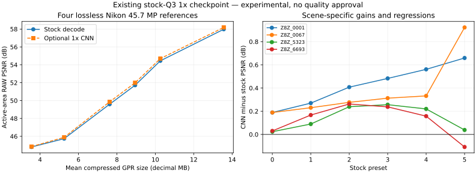

# Optional stock 1x reconstruction: current evidence

The existing stock-Q3 BIBO1x model provides a modest RAW distortion improvement
on four lossless Nikon references. It does not establish the earlier fused
codec's restored tiers or 2x/8K quality approval. Restoration remains opt-in.

A separate [fresh source-grouped Q3 cleanup experiment](stock-cleanup-training.md)
now supplies an audited 1x training path. All 30 evaluated trained checkpoints
failed its validation region guard, so it retained the identity fallback.
It does not replace or approve the legacy model measured below.

The earlier camera-GPR replay experiment showed worse PSNR after reconstruction,
but its reference had already undergone camera compression. This new experiment
uses independently decompressed lossless DNG counts as the reference. Those are
different questions; neither result should silently replace the other.

## Workflow

Encode and decode without Torch using the [stock still workflow](stock-still-quality.md).
For experimental restored editable DNG, explicitly select the model and its
checkpoint. The legacy BIBO architecture is now bundled; an external
architecture override remains optional:

```sh
python tools/stock_still.py restore source.gpr --sample-bits 14 \
  --sdk build/source/app/gpr_tools/gpr_tools \
  --checkpoint /path/to/BayInBayOut_1x_AAon_w16_ANE_gpr_tools_q3.pt \
  --device mps --tile 256 --halo 64 --output restored.dng
```

This optional action requires Torch and numpy; weights remain external.
Bundled 1x/2x architecture and geometry support are described in
[portable reconstruction](stock-cnn-portable.md). CPU/CUDA device selection is also exposed, but the reported
real-model measurements below use MPS. Ordinary encoding/decoding still use
only the Python standard library and SDK executable. No weights are downloaded.

The 1x reconstruction adapter accepts RGGB14 and returns same-size,
four-plane Bayer, normalized by 16383. Explicit 2x support now exists with
[separate calibration transforms and quality evidence](stock-cnn-portable.md). It rejects other still count/CFA formats,
nonfinite predictions and wrong-shaped outputs. Output cores do not overlap;
context halos and replicated edge padding respect the network's multiple of
eight. Other still formats remain available without reconstruction.

The source's exact supported typed calibration, including nonstandard
WhiteLevel and fractional black levels, is retained in the output DNG.
A private full-domain GPR carrier resolves the legacy SDK's count-domain
inference without changing published calibration. Receipts record source,
payload, decoded/restored counts, output and SDK hashes, model/architecture
identity, tile/halo, normalization, inference time and lack of quality approval.
Exclusive output publication refuses overwrites and rolls back owned partials.
Optional [reconstructed GPR re-encoding](#optional-reconstructed-gpr) now uses
an explicit additional preset. Explicit 2x calibration scaling is covered by
the separate portable-reconstruction milestone.

## Optional reconstructed GPR

Add `--gpr-output restored.gpr --gpr-quality 3` to the restore command to save
both an exact reconstructed editable DNG and a newly compressed GPR. This
works for the existing RGGB14 1x/2x reconstruction contracts; it does not expand
the model's supported formats or approve its quality. `--gpr-quality 0..5` is
required with the additional output, and is rejected without it. Other restore
commands retain their previous output and pixel hashes.

```sh
python tools/stock_still.py restore source.gpr --sample-bits 14 \
  --sdk /path/to/gpr_tools --checkpoint /path/to/explicit-checkpoint.pt \
  --device mps --output restored.dng \
  --gpr-output restored.gpr --gpr-quality 3
```

Both files and their joint DNG-side JSON receipt use exclusive local creation
with rollback of owned outputs on failure. Existing names, aliases and races
are rejected without replacing another writer's output. There is no separate
GPR-side receipt: the joint receipt's `reencoded_gpr` contains the chosen preset,
input/output/payload hashes, SDK encoding receipt and a fresh decoded-pixel hash.
The top-level restored-pixel hash always describes the DNG/model output.

GPR re-encoding is **lossy**. Its decoded pixels are distinct from the exact
reconstructed DNG, even when the model itself is an identity fallback. The
joint receipt checks supported calibration and freshly decodes the additional
GPR through a private full-domain carrier; `decoded_matches_restored` reports
identity rather than assuming it. No quality tier or default is selected.

Two real-image checks cover a 45.7 MP Nikon 1x output and an 8192x6144
camera-still-derived 2x output at Q3. Every new payload matches the independent
historical stock encoder; every decoded pixel matches the independent historical
decoder; all supported typed calibration agrees across DNG/GPR/redecoded DNG.
The 1x DNG retains its exact earlier evaluated file and pixel hashes.
On that one lossless-reference Nikon scene, restored-DNG PSNR is **55.986 dB**,
but the Q3-recompressed GPR decodes to **55.316 dB**. Thus re-encoding can erase
the restoration gain; functional output support is not a fidelity improvement.
The 2x check establishes format/transport, not high-resolution ground truth.

[Real-image receipt](stock-restored-gpr-receipts/real-images.json),
[eight optional reconstruction contracts](stock-restored-gpr-receipts/contracts.txt)
and [ordinary still regression checks](stock-restored-gpr-receipts/ordinary-stills.txt)
record this boundary. Weights and photographs remain external.

The full [Release suite passes 21/21 targets](stock-restored-gpr-receipts/release-tests.txt).
All [four relocated package profiles](stock-restored-gpr-receipts/packages.json)
pass C/C++/SDK and installed PCM/timecode checks. The installed full package
reproduces both real-image DNG/GPR files and decoded pixels exactly. Its capture,
preview compiler and player binaries also match the hashes from the preceding
60-second Mission 1 measurement; see the
[installed validation receipt](stock-restored-gpr-receipts/installed-validation.json).

## Lossless-reference measurements

Four Nikon Z8 DNGs (`Z8Z_0001`, `0067`, `5323`, `6693`), each 8280x5520,
RGGB14, were encoded with all six stock presets. Independent tifffile/imagecodecs
decompression matched each source RAW exactly. The new evaluator verifies the
source/benchmark hashes, fresh SDK decoding, calibration and every reconstructed
editable pixel; it measures the production `stock_still.py` restoration path.
All **24 comparisons** completed. Source photographs and model weights are not
included in the repository.

The checkpoint SHA-256 is
`df22af432710bddabd223047c2db2d0edf2808dd17c4341694a974e045ec87cd`,
with `F_ane_no_sr`, width 16, depth 3, residual scale 0.01 and raw normalization
16383. Its saved validation scores are not reused as new measurements.
Training-split membership of these four images is unknown; they are not claimed
as a held-out validation set.

| Preset | Mean GPR MB | Stock PSNR | Restored PSNR | Improvement | Per-scene improvement range |
|---|---:|---:|---:|---:|---:|
| Q0 | 3.553 | 44.81 | 44.85 | +0.04 dB | +0.02 to +0.19 dB |
| Q1 | 5.253 | 45.74 | 45.89 | +0.15 dB | +0.09 to +0.27 dB |
| Q2 | 7.621 | 49.59 | 49.86 | +0.26 dB | +0.24 to +0.41 dB |
| Q3 | 8.948 | 51.72 | 51.99 | +0.27 dB | +0.24 to +0.48 dB |
| Q4 | 10.261 | 54.45 | 54.69 | +0.25 dB | +0.16 to +0.56 dB |
| Q5 | 13.563 | 57.98 | 58.18 | +0.20 dB | **-0.11 to +0.92 dB** |

MB are decimal. PSNR pools active-area squared error across the equal-size,
equal-active-area images before converting to dB; it does not average dB.
Full-scale peak is 16383, rather than each camera's smaller WhiteLevel.
The individual receipts also include site, reference-gradient, shadow and
highlight metrics. These masks measure RAW distortion, not visual approval or
temporal stability. Q5 on `Z8Z_6693` regresses despite the aggregate gain.
Restored Q2 remains below ordinary Q3 in this aggregate comparison; a new
smaller-file equivalent-quality tier has not been established.



Median tiled inference was **0.701 s per 45.7 MP frame** on M5 Max/MPS with
Torch 2.12.0, tile 256 and halo 64 plane pixels. This includes tile transfers
and synchronization; the first invocation is not warmed up. It excludes
the full decode/publication/verification workflow and is not a camera rate.
Pi inference, rendered color/detail/noise review and temporal footage remain
untested for this checkpoint/workflow.

## Reproduce and inspect

After creating an unmodified `benchmark_stills.py` lossless-DNG benchmark:

```sh
python tools/benchmark_stock_cnn.py --source source.dng \
  --benchmark-dir /path/to/still-benchmark \
  --sdk build/source/app/gpr_tools/gpr_tools \
  --cnn-root /path/to/tools/cnn --checkpoint /path/to/checkpoint.pt \
  --device mps --quality 0 --quality 1 --quality 2 \
  --quality 3 --quality 4 --quality 5 --output-dir /new/cnn-benchmark

python tests/stock_cnn_test.py --sdk build/source/app/gpr_tools/gpr_tools
python docs/stock-cnn-receipts/plot.py
```

The evaluator adds numpy/tifffile/imagecodecs to the optional Torch dependencies;
the plotting script needs matplotlib. Optional contract tests require no trained
weights: they compare tiled spatial filtering with whole-image inference,
reject NaN/RGB/2x output, check exact typed calibration with fractional black
and nonstandard white levels, verify identity reconstruction against independently
read decoded counts, and reject overwrite/invalid tiling. All three tests pass
locally on CPU. They are separate from the ten ordinary CTest targets.

After this integration, all ten ordinary CTest targets pass on Pi 5 Release
in 2.78 seconds; [the receipt](stock-cnn-receipts/pi5-release.json) verifies
407 source/test/tool/build/fixture files against commit `71dbace`. This exercises
the no-CNN workflow on Pi, not Torch inference. The preceding preset snapshot
`339b17a` passes all ten Pi ASan/UBSan/leak tests in 1285.46 seconds;
[its separate receipt](stock-still-quality-receipts/pi5-gates.json) preserves that
revision boundary.

Detailed receipts: [summary](stock-cnn-receipts/summary.json),
[0001](stock-cnn-receipts/z8-0001.json), [0067](stock-cnn-receipts/z8-0067.json),
[5323](stock-cnn-receipts/z8-5323.json), [6693](stock-cnn-receipts/z8-6693.json).
Each report records tool-source hashes, reference/input/output identity and
model provenance. Partial evaluations explicitly retain `complete=false`.

Bundled architecture/distribution and explicit 2x calibration are now implemented.
Compatible stock-trained 2x selection, clean broader-camera references,
training-split audit, temporal tests and actual visual approval remain part of
the full rebuild goal.
