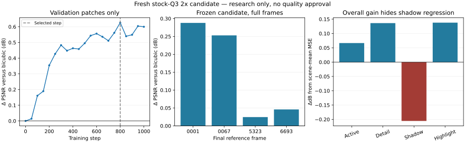

# Fresh stock-Q3 2x training and evaluation

A fresh BIBO2x candidate now trains against actual stock-Q3 inputs and loads
through the [portable runtime](stock-cnn-portable.md). Its four-image final
evaluation improves overall RAW PSNR by **0.02–0.29 dB**, but the pooled gain is
only **0.07 dB** and shadow-region error worsens. It remains an external research
candidate, with no production/visual/temporal approval and no default selection.
The [legacy checkpoint failures](stock-cnn-portable.md#2x-quality-legacy-transfer-rejected)
remain recorded separately.

## Source splits and input contract

The recipe uses the same simulation as the earlier comparison: deinterleave
RGGB14 source counts, average each same-color 2x2 block with integer rounding,
then actually encode/decode the resulting 4140x2760 Bayer image using stock Q3.
Targets are the original 8280x5520 DNG counts. Independent tifffile/imagecodecs
and SDK decoding agree for every training/validation source. This tests a
declared simulated stock input, not the old fused decimator or a real 12 MP
sensor sequence.

| Split | Declared capture groups | Frames | Patches |
|---|---|---:|---:|
| Training | BarnAndSky, FieldAndSky, 118NCZ_8, 2026-01-18 | 8 | 512 |
| Validation | ForestFire, ColoradoSky | 4 | 128 |
| Final evaluation | Z8Z_0001, 0067, 5323, 6693 | 4 | **0 in training arrays** |

Two frames (`001`, `010`) come from each dated training/validation timelapse
group. Whole declared groups stay in one split; source byte hashes are unique.
The final reference RAW pixel hashes are also disjoint from every training and
validation reference. These checks establish source identity separation, not
perceptual near-duplicate detection or broad camera/scene coverage. All images
are from one camera family. Patches overlap and are not independent scenes.

The builder hashes final-test files for identity but does not decode their
pixels into the patch arrays. It records each training/validation crop's source,
split, exact low-plane coordinates, source/reference/encoded/decoded hashes,
calibration omissions, SDK identity and source-code hashes. Partial builds keep
`complete=false`; input/target arrays are hashed when complete. Downsampled
metadata follows the simulation's explicit supported boundary; opaque XMP is
omitted rather than silently carrying stale dimensions.

## Training and selection

The candidate starts from fresh seeded weights, with a zero residual head;
it does not inherit an earlier checkpoint's unknown training history. The
bundled width-16, three-level BIBO U-Net predicts a residual over clipped
per-plane bicubic interpolation with residual scale 0.01 and normalization 16383.

- Each patch has 128x128 low-resolution plane pixels and a 256x256 target.
  Source coordinates align to multiples of eight. Loss uses the central
  128x128 output core, retaining context around it.
- AdamW, learning rate 0.0003, weight decay 0.0001, batch 8, seed 20261028,
  1000 steps; normalized MSE loss scaled by 10000.
- Every 50 steps, validation rounds predicted counts exactly as deployment
  does, then accumulates count-domain squared error on CPU. This also avoids
  unsupported MPS float64 tensor arithmetic.
- The lowest **validation** rounded-count MSE selects the checkpoint.
  Step **800** wins: MSE **8766.40 → 7589.40**, a **0.626 dB** gain. Selection
  does not use final-image scores. A zero-residual step-0 fallback is retained
  if training cannot improve the baseline.
- The selected checkpoint hash was frozen before final evaluation and matches
  every final inference receipt. Later optimization steps did not replace it.

The selected file is 1,318,861 bytes, SHA-256
`3a6fa544e1d5d2e07ced41018795c2daa572f577c2fbed9196a290f2c998febf`.
The local research artifact is under
`/Volumes/OWC_8TB/gpr_work/artifacts/stock_sr_20261028/train/best.pt`.
Weights and source images remain external. Runtime acceptance of its schema is
not model-registry promotion or quality approval.

## Frozen final evaluation

Each final image is independently decoded, freshly downsampled and stock-Q3
encoded/decoded. Its low-resolution compressed bytes and decoded counts match
the corresponding earlier legacy-model experiment exactly. The candidate and
bicubic baseline therefore receive the same inputs used in that comparison.
Independent TIFF reads verify reconstructed counts against inference hashes
and calibration against the expected transform.

| Source | Bicubic PSNR | Fresh candidate PSNR | Gain |
|---|---:|---:|---:|
| Z8Z_0001 | 48.212 dB | 48.500 dB | +0.288 dB |
| Z8Z_0067 | 58.286 dB | 58.539 dB | +0.253 dB |
| Z8Z_5323 | 43.850 dB | 43.874 dB | +0.025 dB |
| Z8Z_6693 | 40.648 dB | 40.694 dB | +0.046 dB |

Pooled active-area PSNR improves **44.439 → 44.506 dB**. The source active
areas have equal sample counts, so averaging their MSEs is equivalent to pooling
their squared errors; no dB averaging is used. Full-scale peak is 16383.

Reference-only region masks expose a limitation hidden by that aggregate:
averaging each scene's masked MSE before converting to a relative dB change gives
detail **+0.136 dB**, shadow **-0.205 dB**, highlight **+0.138 dB**. These masked
sample counts vary by scene, so this is explicitly scene-mean MSE, not pooling
all masked pixels. The shadow regression blocks a balanced quality claim.
Full per-site, bias, percentile, gradient and region metrics are retained.



Median diagnostic tiled inference is **0.268 s** on M5 Max/MPS for an
11.4 MP decoded input to 45.7 MP output, with tile 256 and halo 64. The first
invocation includes warm-up. This is not full-workflow throughput or a Pi/camera
inference claim. Actual color rendering, perceptual detail/noise review, temporal
stability, broader-camera references and restored-tier approval remain pending.

## Reproduce and verify

The development recipe requires Torch/numpy/tifffile/imagecodecs and the native
SDK CLI; it is not a capture-runtime dependency. A source manifest has schema
`gpr.stock_sr_sources.v1` and rows with `path`, `group`, `split` (`train`,
`validation`, `test`), plus optional expected `sha256`. Group overlap, duplicate
source bytes and an absent split are rejected.

```sh
python tools/train_stock_sr.py build --sources sources.json \
  --sdk build/source/app/gpr_tools/gpr_tools --output-dir /new/dataset
python tools/train_stock_sr.py train --dataset /new/dataset \
  --device mps --steps 1000 --batch 8 --validate-every 50 --output-dir /new/train
python tools/benchmark_stock_sr.py --source final-reference.dng \
  --sdk build/source/app/gpr_tools/gpr_tools --checkpoint /new/train/best.pt \
  --device mps --output-dir /new/final-evaluation
```

Training verifies array hashes, Bayer/count/shape contracts, source-group and
patch partition isolation, and absence of test patches. Checkpoints are written
through a temporary file and loaded through the normal `stock_video.load_cnn`
contract. Perfect-reference PSNR is represented by JSON null, with zero-residual
fallback selection, rather than invalid JSON infinity. Seeds and code/artifact
hashes identify this run; exact floating-point reproduction across devices or
Torch versions is not promised.

Seven local optional CPU/Torch tests pass. The new test exercises source-group
and duplicate-source rejection, a one-step train-to-runtime checkpoint roundtrip,
independent validation-MSE reconstruction, test-pixel leakage rejection, perfect
reference handling and array tampering. It requires no external weights/photos.
The six preceding contracts also pass hosted Linux Release at `67f5895`; its
Linux sanitizers and Windows native packages pass, while macOS remained queued.
The seventh test and new recipe have their own latest hosted gate.

Receipts and exact source revisions:

- [Sources](https://github.com/dcliftreaves/gpr/blob/170802d44c28cde77dfdb9c31bb45244297c21a8/docs/stock-sr-training-receipts/sources.json),
  [dataset](https://github.com/dcliftreaves/gpr/blob/170802d44c28cde77dfdb9c31bb45244297c21a8/docs/stock-sr-training-receipts/dataset.json): builder `417ad0c`.
- [Training](https://github.com/dcliftreaves/gpr/blob/170802d44c28cde77dfdb9c31bb45244297c21a8/docs/stock-sr-training-receipts/training.json): recipe `e939690`.
- [Frozen selection](https://github.com/dcliftreaves/gpr/blob/170802d44c28cde77dfdb9c31bb45244297c21a8/docs/stock-sr-training-receipts/test-selection.json),
  [final summary](https://github.com/dcliftreaves/gpr/blob/170802d44c28cde77dfdb9c31bb45244297c21a8/docs/stock-sr-training-receipts/summary.json): evaluator `848c96b`.
- Final images: [0001](https://github.com/dcliftreaves/gpr/blob/170802d44c28cde77dfdb9c31bb45244297c21a8/docs/stock-sr-training-receipts/test-0001.json),
  [0067](https://github.com/dcliftreaves/gpr/blob/170802d44c28cde77dfdb9c31bb45244297c21a8/docs/stock-sr-training-receipts/test-0067.json),
  [5323](https://github.com/dcliftreaves/gpr/blob/170802d44c28cde77dfdb9c31bb45244297c21a8/docs/stock-sr-training-receipts/test-5323.json),
  [6693](https://github.com/dcliftreaves/gpr/blob/170802d44c28cde77dfdb9c31bb45244297c21a8/docs/stock-sr-training-receipts/test-6693.json).

All recorded runtime/tool hashes were checked against those Git revisions.
The complete high-level rebuild continues with rendering/interchange, integrated
preview/capture and the outstanding quality/format/release work.

## Strength selection and shadow-weighted follow-up

The [follow-up study](stock-sr-balanced.md) rejects all 17 reduced strengths
of the existing checkpoint for shadow regression. Fresh shadow-weighted
training yields a validation-qualified 1/16-strength candidate, frozen before
full-reference evaluation, but it regresses one reference's shadows and
another's highlights. No new 2x weights are supplied or promoted. These failures
preserve the original strict guard; the separate 1x candidate is unchanged.

The subsequent [region-balanced loss study](stock-sr-relative.md) improves
shadows/highlights on all historical final references but regresses overall
and detail error on two, so it also remains unapproved. Full-frame diagnostics
on its four validation sources fail three guards despite passing patch guards;
future selection needs full-frame validation before final testing.

The [full-image selection stage](stock-sr-full-selection.md) is now implemented
and tested on Mac/Pi. Ten patch-qualified snapshot/strength candidates all fail
its complete-image guard, so this follow-up selects no checkpoint and skips
final-reference testing. No failed weights are promoted.

The later [source-wide loss study](stock-sr-source-regions.md) retains the
original guards and checks all 22 patch-qualified combinations on full images.
Its selected 1/32-strength model passes all four historical final references
on MPS/CPU and Pi execution/count checks. An explicit diagnostic checkpoint is
supplied; pooled gain is small (+0.00729 dB), and broader/restored-tier quality
approval remains open. Older failures above remain revision-bound.
