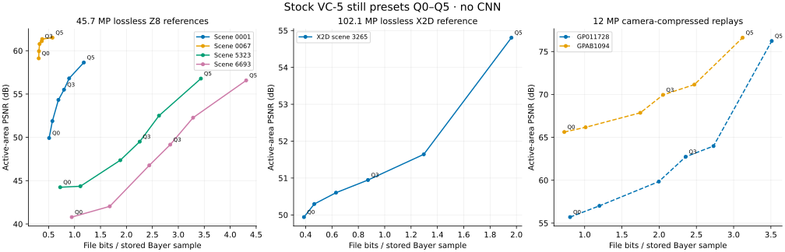
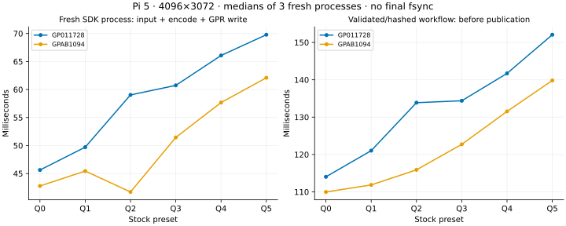

# Selectable stock still presets and measured tradeoffs

All six historical stock presets are now selectable through the still SDK and
`gpr_tools`, with a separate workflow that preserves typed source calibration.
No CNN runs in these measurements. The earlier feature PR's three restored
still tiers and its quality approvals are not inherited by this port.

## Use the workflow

```sh
# A lossless source DNG: declare its actual count domain, not its storage word size.
python3 tools/stock_still.py encode source.dng --source-type dng --sample-bits 14 \
  --quality 3 --sdk build-runtime/source/app/gpr_tools/gpr_tools --output still.gpr

# A packed array of little-endian uint16 words with explicit source calibration.
python3 tools/stock_still.py encode sensor.raw --metadata calibration.json \
  --quality 0 --sdk build-runtime/source/app/gpr_tools/gpr_tools \
  --output compact.gpr --editable decoded.dng

# Decode using an explicit count domain and retain the original calibration.
python3 tools/stock_still.py decode still.gpr --sample-bits 14 \
  --sdk build-runtime/source/app/gpr_tools/gpr_tools --output editable.dng
```

`--quality` is required for this workflow. Q0–Q5 map to stock LOW, MEDIUM,
HIGH, FS1, FSX and FS2. They are compression presets, not promises of equal
quality across cameras or scenes. The internal transform remains the historical
12-bit logarithmic profile; 14/16-bit containers do not make it lossless.
The frontend accepts all four standard Bayer layouts, word-packed 12/14/16-bit
counts and even dimensions at least 48 samples per axis. Transform-boundary
tests include 48x48, 50x50, 130x96 and 128x98; the measured X2D image is
11664x8750, including a height that is not divisible by eight.

The native SDK adds `gpr_convert_raw_to_gpr_with_quality` and
`gpr_convert_dng_to_gpr_with_quality`. An explicit 0–5 preset overrides
`fast_encoding`; existing entry points retain Q3 normally and Q1 with that
legacy flag. Invalid presets fail before allocating output. The CLI accepts
`-q 3`, `--quality 3` and `--quality=3`. `--no-preview` omits JPEG generation
and its RGB work. Supplying a pre-encoded preview also avoids computing an
unused thumbnail. The encoder now follows the caller's allocator callbacks;
tagged-allocator tests check ownership through encoding and thumbnail cleanup.

## Calibration and count domains

The workflow encodes through a private SDK GPR, extracts its stock payload,
then packages it with the original typed calibration. It preserves the
supported image/EXIF/GPS tag records, including fractional black levels,
nonstandard WhiteLevel and opaque opcodes. This extends the workflow beyond
the limits of the legacy SDK parameter struct. For decoding, a private carrier
uses full-domain WhiteLevel to tell the SDK whether to produce 12-, 14- or
16-bit counts; the final editable DNG retains the original WhiteLevel and
other calibration. Calibration hashes cover canonical typed tag bytes rather
than JSON ordering, compression of the metadata records or provenance fields.

Raw extraction from DNG now avoids an unnecessary legacy metadata-struct parse.
Source geometry and CFA still have to match the supplied calibration. Input
sizes and sample domains are checked. SDK word-domain validation uses a bitwise
reduction over the real samples, excluding padding; the compiler check emits
an eight-wide loop with four-way interleaving on AArch64. The Python validation
uses C-backed byte translation and reuses already computed hashes.

Outputs are created exclusively, with JSON receipts binding source/raw,
calibration, compressed payload, output and SDK binary hashes. Preparation
happens in a private directory on the output filesystem. Current publication
uses atomic exclusive links when supported, with exclusive copying for exFAT
or cross-filesystem destinations. A failed publication removes only names
created by that operation, including partial copies. Receipts and editable
outputs can use separate directories. The scripts use the
standard library; optional benchmarks need numpy/tifffile and imagecodecs for
independent lossless-DNG decoding. Exact preservation boundaries and TIFF/DNG
version limits remain those in [editable RAW](stock-editable-raw.md).

Additional formats require a reader that understands their count domain and
CFA. A byte-compatible stock VC-5 payload does not establish that every old
GPR editor accepts every new container/layout. Use the explicit-domain decoder
when the legacy metadata reader cannot infer a nonstandard saturation level.

## Results

The nine benchmark sets at implementation `9adbc90` use three fresh processes per preset/input. Five are
lossless source DNGs: four 8280x5520 Z8 frames and one 11664x8750 X2D frame.
Their reference arrays match independent imagecodecs/tifffile decompression
exactly. The other four sets are the two 4096x3072 camera GPR inputs on macOS
and Pi 5. Their reference has already undergone camera compression. All nine
sets use identical manifests of 384 source/test/build files. The camera input,
calibration, payload and decoded-pixel hashes match exactly across hosts;
floating metrics agree within 1e-12.



File sizes below are decimal MB. Z8 values are mean GPR size across four
frames; its PSNR pools active-area squared count errors before taking the log.
The X2D result is one frame. PSNR uses the declared full count-domain peak;
it is not a perceptual score. The complete receipts additionally report
per-site, shadow, highlight, high-gradient and percentile errors.

| Preset | Z8 mean MB | Z8 pooled PSNR | X2D MB | X2D PSNR |
|---|---:|---:|---:|---:|
| Q0 | 3.553 | 44.81 dB | 4.940 | 49.94 dB |
| Q1 | 5.253 | 45.74 dB | 5.939 | 50.30 dB |
| Q2 | 7.621 | 49.59 dB | 8.043 | 50.60 dB |
| Q3 | 8.948 | 51.72 dB | 11.139 | 50.95 dB |
| Q4 | 10.261 | 54.45 dB | 16.543 | 51.64 dB |
| Q5 | 13.563 | 57.98 dB | 25.029 | 54.81 dB |

A local 1:1 macOS Image I/O crop comparison of Z8 scene 0001 showed visible
texture smoothing/blocking at Q0 in gravel detail. Q5 was closer to the
reference, with remaining differences. Those private photo crops are not
published. This is a visual spot check, not approval of a universal tier or a
restoration model. The clean references now provide a stronger basis for
testing CNN restoration than comparison only against camera-compressed replay.

### Pi 5 timing

Pi 5 uses four A76 cores at 2.4 GHz, the performance governor and USB SSD.
Post-run temperature was 53.2 C; the receipt records the raw throttle status.
The macOS host is an Apple M5 Max with 128 GiB RAM. No builds, tests or other
benchmark runs launched by this work overlapped the measurements on either host. Files were warm in the
cache, no JPEG preview or CNN ran, and no final storage fsync was timed.



| Preset | GP011728 MB | SDK process ms | Prepared workflow ms | GPAB1094 MB | SDK process ms | Prepared workflow ms |
|---|---:|---:|---:|---:|---:|---:|
| Q0 | 1.265 | 45.6 | 114.0 | 1.143 | 42.8 | 110.0 |
| Q1 | 1.885 | 49.7 | 121.0 | 1.593 | 45.4 | 111.9 |
| Q2 | 3.139 | 59.0 | 133.9 | 2.748 | 41.7 | 115.9 |
| Q3 | 3.706 | 60.7 | 134.4 | 3.228 | 51.4 | 122.7 |
| Q4 | 4.294 | 66.1 | 141.7 | 3.890 | 57.7 | 131.5 |
| Q5 | 5.523 | 69.8 | 152.1 | 4.908 | 62.1 | 139.8 |

The SDK-process column includes startup, reading the RAW file, encoding and
writing a temporary GPR. Preparation also validates and hashes input, preserves
typed calibration, writes/hashes the final staged GPR and prepares its receipt.
Its endpoint is before final publication and fsync. It is not the preloaded
encoder-kernel timing from the earlier optimization PRs or a live-video fps
measurement. On the M5 Max, Q3 SDK processes took 25.1–49.5 ms for the four Z8
frames and 66.3 ms for the X2D frame; preparation took 79.5–135.2 and 150.0 ms.
Three repeats describe these runs, not a broad latency distribution.

## Reproduce and remaining work

```sh
python3 tools/benchmark_stills.py --source original.dng --sample-bits 14 \
  --reference-kind lossless_sensor_dng --sdk build-runtime/source/app/gpr_tools/gpr_tools \
  --output-dir new-benchmark --repeats 3
# Use camera_gpr_replay for already-compressed GPR reference material.
```

[Receipts](stock-still-quality-receipts) contain all nine results, deterministic
repeat hashes, source identities and validation/assembly-inspection notes.
`plot.py` there regenerates the figures with matplotlib without source photos.
The tests cover all six SDK presets against direct stock encodes for all
fourteen SDK format selections, retained legacy defaults, invalid presets,
tagged allocator ownership, exact typed calibration, exclusive publication and
boundary geometries. All four local package profiles also pass relocated-client
checks; the full package runs its installed still encode/decode tools and
checks pixel equality. Unsupported-link and partial-copy tests cover publication
fallbacks. Local macOS Release and ASan/UBSan and Pi Release pass
all ten CTest targets. Expanded Pi sanitizer and hosted checks for this
quality-selection implementation remain separate gates.

Selectable stock presets and calibrated still packaging are implemented.
Selecting and approving stock-matched 1x/2x CNNs, recreating the old restored
tiers, and validating their scene/temporal/perceptual behavior remain pending.
The earlier production and validation PRs remain open and unchanged.
